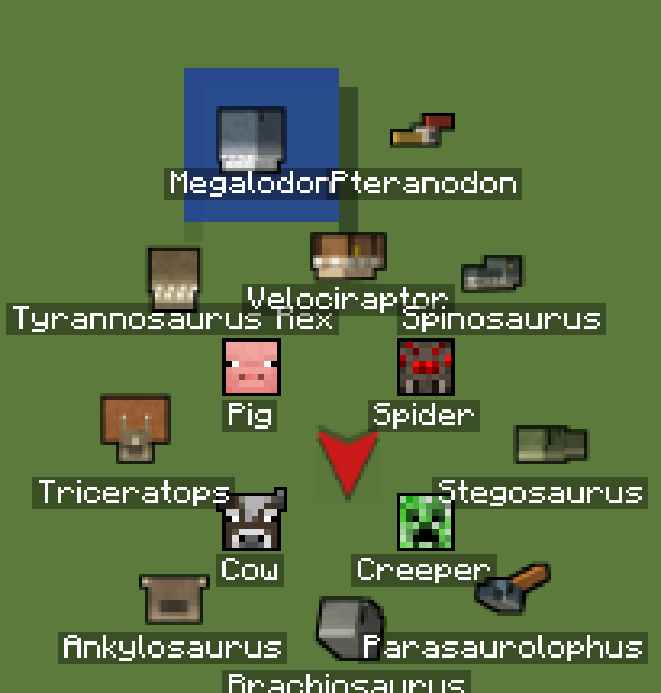
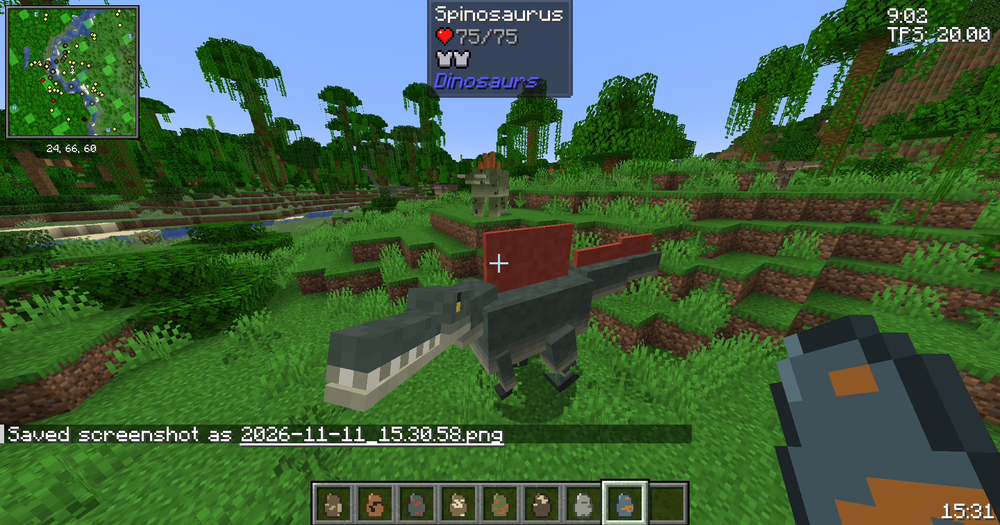
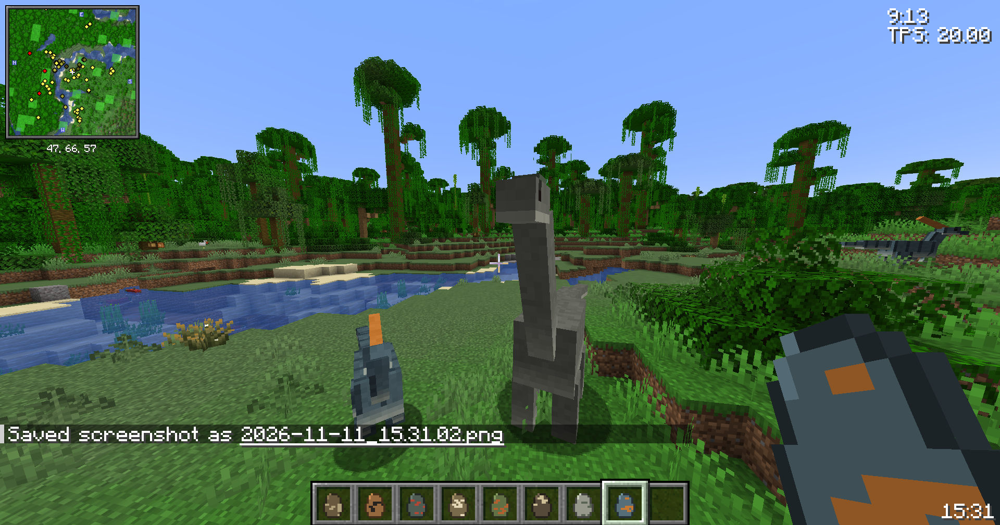
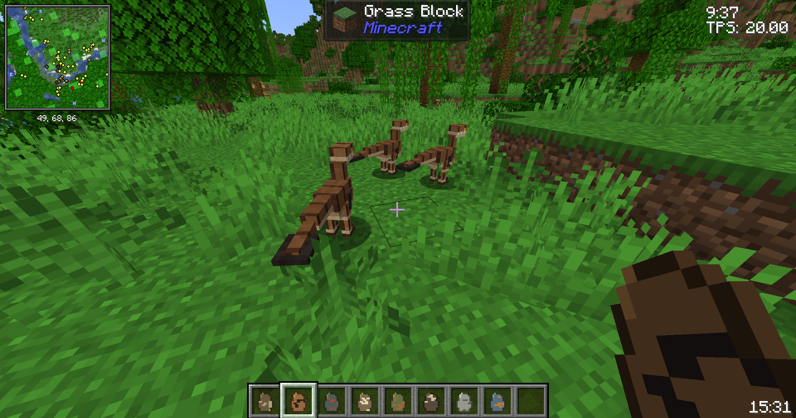
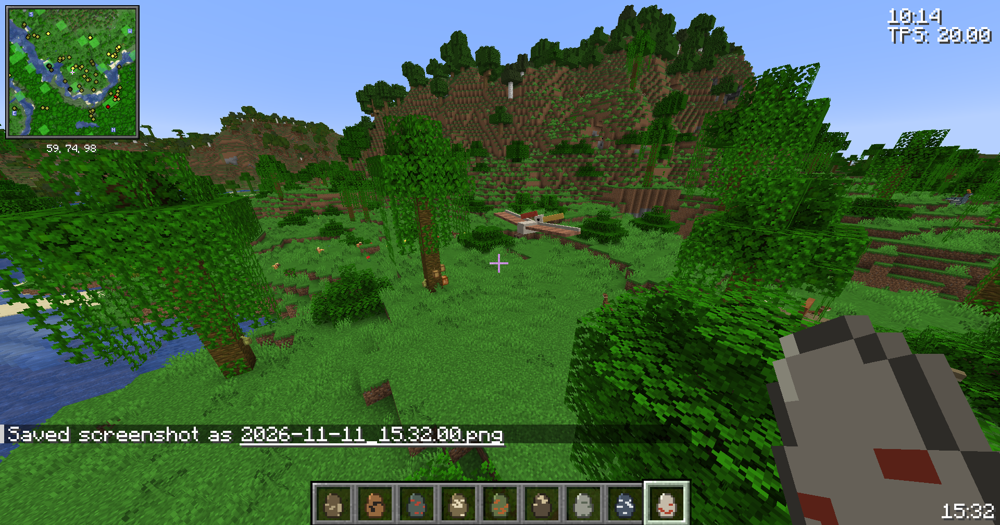

# Dinosaurs (Fabric mod for Minecraft 26.2 / 26.3)

Modrinth: https://modrinth.com/mod/dinosaurs-mod

Adds well-known prehistoric animals as new mobs. Every species lives in its own biomes, so the world
is spread out instead of everything spawning in one place. Behaviour follows current science:
carnivores are hostile, armoured or horned herbivores defend themselves, the others run away.

## Mobs

| Mob | Behaviour | Spawns in | Drops |
|-----|-----------|-----------|-------|
| Tyrannosaurus Rex | Hostile, rare (max 1 per area) | Plains, Sunflower Plains, Forest, Dark Forest | 2-4 **Dinosaur Bones**, bone meal, 1-2 **T-Rex Teeth**, rarely a **T-Rex Skull** |
| Velociraptor (feathered) | Hostile, small packs; hitting one alerts the pack | Savanna, Savanna Plateau, Windswept Savanna, Badlands (all 3) | 0-2 bones, 0-1 **Raptor Claw** |
| Spinosaurus (sail, semi-aquatic) | Hostile, rare | Mangrove Swamp, Beach | 2-4 **Dinosaur Bones**, bone meal |
| Triceratops | Neutral: fights back when hit; **rideable with a Dinosaur Saddle** | Plains, Sunflower Plains, Meadow | 1-3 **Dinosaur Bones**, bone meal |
| Stegosaurus | Neutral: fights back when hit | Forest, Flower Forest, Birch Forest, Old Growth Birch Forest | 1-3 **Dinosaur Bones**, bone meal |
| Ankylosaurus (heavily armoured) | Neutral: fights back when hit | Taiga (all), Windswept Hills / Forest / Gravelly Hills | 1-3 **Dinosaur Bones**, bone meal |
| Brachiosaurus | Passive: flees when hurt and avoids carnivores | Jungle, Sparse Jungle, Bamboo Jungle | 2-5 **Dinosaur Bones**, bone meal, 1-3 **Brachiosaurus Hide** |
| Parasaurolophus | Passive: flees when hurt and avoids carnivores | Swamp, River | 1-2 **Dinosaur Bones**, 0-1 **Parasaurolophus Crest** |
| Megalodon | Hostile to players **in the water**, very rare. Huge: 5 blocks long, 3.6 tall (1.7.0) | Deep Ocean, Deep Cold / Lukewarm / Frozen Ocean | 3-6 bones, bone meal, 1-3 **Megalodon Teeth** |
| Pteranodon | Passive: flies around, perches on the highest nearby point, flees when hurt | Windswept Hills, Windswept Gravelly Hills, Stony Peaks, Jagged Peaks | 0-2 bones |

* Hostile species do not spawn on Peaceful difficulty. Predators spawn during the day too, but they are
  limited per area (for example only one T. rex within 64 blocks) so they never flood a biome.
* Herbivores and pterosaurs stay in the world like vanilla animals; predators despawn like monsters (except a
  collared T. rex, see the Dino Collar).
* Every mob has a spawn egg (creative tab **Dinosaurs** and the vanilla Spawn Eggs tab).
* Looting increases every drop by up to 1 per level (the rare T-Rex Skull: 4%, with Looting I/II/III 6/8/10%).
* Sounds reuse vanilla sounds.

## Items (1.1.0)

**Amulet of Dino Protection** – while it is anywhere in your inventory (or in the Trinkets necklace slot),
hostile dinosaurs (T. rex, Velociraptor, Spinosaurus, Megalodon) do not target or attack you. If you attack
one of them, *that* dinosaur may fight back; the others keep ignoring you.

```
 string  gold ingot  string
 raptor  T-Rex tooth raptor
 claw                claw
         megalodon
         tooth
```

**Dinosaur Saddle** – use it on a Triceratops to saddle it. Then use the Triceratops with an empty hand to
ride it and steer with the movement keys (W/S/A/D). Sneak + use with an empty hand takes the saddle off.
The saddle is saved with the mob and dropped when it dies.

```
 brachiosaurus hide  leather                brachiosaurus hide
 string              parasaurolophus crest  string
                     iron ingot
```

**Dinosaur Field Guide** (1.2.0) – an illustrated guide book. Right-click it to open: a clickable table of
contents, a page for every dinosaur with a 3D picture (drag it to rotate), where it lives and what it drops,
plus every item with its crafting grid (click an ingredient to jump to its page) and the current spawn settings.

```
 shapeless: book + leather + any dinosaur trophy
 (T-Rex tooth, raptor claw, megalodon tooth, brachiosaurus hide or parasaurolophus crest)
```

Book + leather alone is left free so it cannot clash with other mods' guide books; the trophy
(item tag `#dinosaurs:guide_book_trophies`) makes the recipe unique.

**T-Rex Skull Helmet** (1.3.0) – the T. rex rarely drops a **T-Rex Skull** (only when killed by a player:
4% of the time, 6/8/10% with Looting I/II/III). Craft it into a helmet you wear as a 3D T. rex skull, snout
forward, with teeth and eye sockets (on players, armor stands, mannequins and mobs alike). Better than netherite:

| | T-Rex Skull Helmet | Netherite Helmet |
|---|---|---|
| Armor | 4 | 3 |
| Armor Toughness | 4 (1.3.0-1.4.1: 3.5) | 3 |
| Knockback Resistance | 0.2 (1.3.0-1.4.1: 0.15) | 0.1 |
| Durability | 506 | 407 |
| Enchantability | 20 (1.3.0-1.4.1: 15) | 15 |

Since 1.5.0 it is the helmet of the Dinosaur Armor set, so its toughness, knockback resistance and enchantability
were raised to the set's values.

Fire resistant like netherite, takes all helmet enchantments (`#minecraft:enchantable/head_armor`; not trimmable, a trim could not show on the 3D skull), repaired with a
netherite ingot or another T-Rex Skull.

```
 shapeless: T-Rex skull + leather + netherite ingot
```

**Dinosaur Bone Bow** (1.4.0) – the seven large dinosaurs (T. rex, Spinosaurus, Brachiosaurus, Triceratops,
Stegosaurus, Ankylosaurus, Parasaurolophus) now drop **Dinosaur Bones** instead of vanilla bones; Velociraptor,
Pteranodon and Megalodon (a shark: cartilage, not dinosaur bone) keep vanilla bones. One Dinosaur Bones also crafts
into 4 bone meal. Three of them upgrade a bow:

```
  .  B  .     B = Dinosaur Bones
  B  W  B     W = Bow
  .  N  .     N = Netherite Ingot
```

| | Dinosaur Bone Bow | Bow |
|---|---|---|
| Full draw | 15 ticks (0.75 s) | 20 ticks (1 s) |
| Arrow speed at full draw | 4.5 | 3 |
| Arrow damage at full draw (no Power) | 9 | 6 |
| Durability | 1152 | 384 |
| Enchantability | 15 | 1 |

Arrows fly 1.5x faster and farther and hit harder; it takes every bow enchantment, is fire resistant and is
repaired with Dinosaur Bones. **Infinity and Mending can be on it together** – combine them in an anvil or with
`/enchant`; on every other bow the vanilla rule still applies. Draw animation and FOV zoom work like a vanilla bow.
Crafting it from an enchanted bow keeps the bow's enchantments, name and repair cost (1.4.1); damage carries over
as the same fraction of durability.

**Dinosaur Armor** (1.5.0) – an upgrade for netherite armor, made on the **smithing table**, like netherite from diamond.
First craft the **Dinosaur Upgrade** smithing template:

```
  B  B  B     B = Dinosaur Bones
  B  T  B     T = Netherite Upgrade smithing template
  B  B  B
```

Like vanilla templates it is used up; 7 Dinosaur Bones + a Bone Block copy it (template on top, bone block in the middle: 2 templates).
Then on the smithing table: Dinosaur Upgrade + netherite piece + trophy:

| Netherite piece | Trophy (drop) | Result |
|---|---|---|
| Netherite Chestplate | Megalodon Tooth (Megalodon, 1-3) | Dinosaur Chestplate |
| Netherite Leggings | Parasaurolophus Crest (Parasaurolophus, 0-1) | Dinosaur Leggings |
| Netherite Boots | Raptor Claw (Velociraptor, 0-1) | Dinosaur Boots |

(+1 per Looting level.) Enchantments, name, trim and damage carry over, as with the netherite upgrade. The **T-Rex
Skull Helmet** is the set's helmet. Toughness, knockback resistance, durability and enchantability are better than netherite by exactly as much as
netherite is better than diamond, and the armor points are raised too:

| Piece | Diamond | Netherite | **Dinosaur** |
|---|---|---|---|
| Chestplate armor / durability | 8 / 528 | 8 / 592 | **10 / 656** |
| Leggings armor / durability | 6 / 495 | 6 / 555 | **8 / 615** |
| Boots armor / durability | 3 / 429 | 3 / 481 | **4 / 533** |
| Armor toughness (each) | 2 | 3 | **4** |
| Knockback resistance (each) | 0 | 0.1 | **0.2** |
| Enchantability | 10 | 15 | **20** |

Armor points are also higher than netherite: 10 / 8 / 4 (netherite 8 / 6 / 3). Full set with the skull helmet:
26 armor, 16 toughness, 80% knockback resistance. Fire resistant, takes all armor enchantments and trims (shown on the item icon and when worn), repaired
with Dinosaur Bones. When worn it looks bony: ribs and sternum on the chest, vertebrae down the back, bone shoulder
plates, segmented legs with knee caps and toe claws, with dark netherite between the bones.

### Dinosaur Claw (1.6.0)

A clawed gauntlet: a netherite and leather glove with bone knuckle plates and three sharp claws sticking out of the
knuckles. It is worn on the fist in first and third person (its own 3D model). Shaped recipe:

```
  C  T  C     C = Raptor Claw (Velociraptor), T = T-Rex Tooth (Tyrannosaurus Rex)
  N  B  N     N = Netherite Ingot, B = Dinosaur Bones
     S        S = Stick
```

It beats the netherite sword by what netherite beats diamond (durability, enchantability), hits much harder, but as
a fist weapon it has a shorter reach:

| | Diamond Sword | Netherite Sword | **Dinosaur Claw** |
|---|---|---|---|
| Attack damage | 7 | 8 | **11** |
| Attack speed | 1.6 | 1.6 | **1.6** |
| Reach (blocks) | 3 | 3 | **2.5** |
| Durability | 1561 | 2031 | **2501** |
| Enchantability | 10 | 15 | **20** |

The reach is an `entity_interaction_range` attribute modifier of -0.5 while it is in the main hand (vanilla uses that
attribute as the attack reach of weapons without an `attack_range` component), so mobs and players have to be half a
block closer; it shows in the tooltip. It fights like a sword (`#minecraft:swords`): sweeping attack, every sword
enchantment (Sharpness, Sweeping Edge, Looting, Fire Aspect...), cuts cobwebs. Fire resistant, repaired with Dinosaur Bones.

### Dino Collar (1.7.0)

A studded leather collar with three T-Rex teeth. Carry the **Amulet of Dino Protection** (inventory or Trinkets
necklace slot) and use the collar on a **Tyrannosaurus Rex**: the collar is used up and the T. rex becomes yours. Shaped recipe:

```
  T  T  T     T = T-Rex Tooth (Tyrannosaurus Rex)
  L  B  L     L = Leather, B = Dinosaur Bones
     C        C = Iron Chain
```

A collared T. rex (you can see the collar on its neck):

* **follows you** like a tamed wolf and teleports next to you when it falls more than 12 blocks behind;
* **fights for you**: attacks whatever you attack and whatever attacks you, and never attacks you;
* is **neutral to other players**: it ignores them unless they attack you (or the T. rex itself);
* **never despawns** (not even on Peaceful) and does not keep you from sleeping;
* sneak + use with an empty hand: **sit** (stays put, does not fight) / follow again; feed it any meat to heal it;
* drops its collar when it dies; the owner is saved with the mob (`Owner` UUID), so it stays yours after a restart.

Without the amulet the collar does nothing; only the T. rex takes a collar, and a collared one keeps its first owner.

Advancements: *Dino Whisperer* (get the amulet), *Who's a Good Rex?* (collar a T. rex) and *Three Horns, One Rider*
(ride a Triceratops).

## Configuration

`config/dinosaurs.json` (created on first start):

* `hostileSpawnInDaylight` (default `true`) – set to `false` and hostile dinosaurs only spawn at night,
  in darkness (light level 7 or less). Applies immediately.
* `spawning` – turn natural spawning of each species on or off. Spawn eggs, spawners and `/summon` always work.
  Applies immediately.
* `spawnFrequencyPercent` (1.7.0, default `100`, 0-500) – global spawn frequency: multiplies every species' weight
  (200 = twice as common, 0 = no natural dinosaur spawns).
* `spawnWeights` (1.7.0, 0-100 per species) – spawn weight of each species in its biomes, compared with the other mobs
  there (vanilla cow / sheep / pig: 10-12). Defaults: T. rex 4, Velociraptor 14, Spinosaurus 6, Triceratops 6,
  Stegosaurus 6, Ankylosaurus 5, Brachiosaurus 5, Parasaurolophus 8, Megalodon 1, Pteranodon 8. 0 = never.

The weights go into the biomes' spawn lists, which the game builds when a world loads: **change them, then leave and
re-join the world (or restart the server)**. The on/off switches work at once.

With [Mod Menu](https://modrinth.com/mod/modmenu) **and** [Cloth Config](https://modrinth.com/mod/cloth-config)
installed, the same settings are available in-game (Mods → Dinosaurs → config button), in English and Polish:
a *Spawning* tab (switches) and a *Spawn frequency* tab (global percentage slider and a weight slider per species).

## Optional integrations

| Mod | What it does |
|-----|--------------|
| [Trinkets Updated](https://modrinth.com/mod/trinkets-updated) (Fabric port of Trinkets) | The amulet goes in the **chest / necklace** slot and protects from there |
| [Mod Menu](https://modrinth.com/mod/modmenu) + [Cloth Config](https://modrinth.com/mod/cloth-config) | In-game config screen |
| [Xaero's Minimap](https://modrinth.com/mod/xaeros-minimap) / Better PvP (1.5.1) | Dinosaur head icons on the entity radar, like vanilla mobs (resource files only, no code) |



None of them is required. (Baubles and Curios are Forge/NeoForge-only; Accessories has no build for 26.x.)

## Languages

English and Polish. Minecraft picks the language automatically from the game settings.

## Requirements

* Minecraft 26.2 or 26.3 (use the matching jar)
* Fabric Loader 0.19.5+ (26.2) / 0.20.1+ (26.3)
* [Fabric API](https://modrinth.com/mod/fabric-api)
* Java 25
* Optional: Trinkets Updated, Mod Menu, Cloth Config, Xaero's Minimap (see above)

Install on the server **and** on every client.

## Screenshots

These are in-game screenshots of the mobs:












## Building

```bash
./gradlew build                     # jar in build/libs/
python3 tools/gen_assets.py         # regenerates models (DinoModelLayers.java), textures, spawn egg icons
python3 tools/gen_data.py           # regenerates lang files, loot tables, item models, recipes, advancements
python3 tools/gen_items.py          # regenerates the item textures and the Triceratops saddle overlay
./tools/server-test.sh              # headless dedicated-server smoke test
python3 tools/gen_bow.py /path/to/vanilla/textures/item   # Dinosaur Bones and Bone Bow textures
python3 tools/gen_skull.py          # regenerates the 3D T-Rex Skull / helmet models and their textures
python3 tools/gen_armor.py          # Dinosaur Armor worn layers, item icons, the upgrade template and smithing slot icons
python3 tools/gen_claw.py           # Dinosaur Claw icon, gauntlet texture and 3D held model
python3 tools/gen_collar.py         # Dino Collar icon and the collar texture worn by a collared T. rex
./gradlew runGameTest               # server game tests (dino collar: amulet, ownership, never attacks the owner, defends the owner, persistence / no despawn, sit, drop, recipe; megalodon size; spawn weights; dinosaur claw recipe / stats / reach, amulet, saddle/riding, config, recipes, guide book, helmet, skull loot, bone bow, Infinity + Mending, dinosaur bones loot, dinosaur armor stats / smithing / template recipes / trophy loot); add -PwithTrinkets=true
SDL_VIDEODRIVER=offscreen ./gradlew runClientGameTest   # guide book layout check + screenshots, claw, armor, helmet, bone bow and mob screenshots
./gradlew runClientGameTest -PcollarOnly=true -PwithCloth=true   # 1.7.0: collared T-Rex, follow/teleport, 2x Megalodon, config screen, collar recipe (/workspace/dino-collar)
SDL_VIDEODRIVER=offscreen ./gradlew runClientGameTest -PxaeroJar=/path/to/xaerominimap-fabric-26.3-26.6.2.jar [-PxaeroRadar=always]
                                    # Xaero's Minimap radar screenshots only (icons with Tab held, or always on with names)
```

Branches: `master` targets Minecraft 26.3, branch `26.2` targets Minecraft 26.2.

## License

MIT

---

## Po polsku

Mod dodaje do Minecrafta dinozaury (i dwa inne prehistoryczne zwierzęta). Każdy gatunek ma swoje biomy,
więc nie pojawiają się wszystkie w jednym miejscu.

* **Wrogie (mięsożerne):** Tyranozaur (równiny, lasy, rzadki), Welociraptor (sawanny i badlandy, w małych stadach),
  Spinozaur (bagna namorzynowe i plaże), Megalodon (głębokie oceany, atakuje tylko gracza w wodzie).
* **Neutralne (bronią się, gdy je uderzysz):** Triceratops (równiny, łąki), Stegozaur (lasy, lasy brzozowe),
  Ankylozaur (tajgi, wietrzne wzgórza).
* **Pokojowe (uciekają):** Brachiozaur (dżungle), Parazaurolof (bagna, rzeki),
  Pteranodon (góry: lata i siada na najwyższych punktach).
* Łupy: kości (duże dinozaury: kości dinozaura) i mączka kostna. Każde zwierzę ma jajo przywołania w trybie kreatywnym.
* **Nowe w 1.1.0:** zęby tyranozaura, pazury raptora i zęby megalodona → **Amulet ochrony przed dinozaurami**
  (wrogie dinozaury cię ignorują, dopóki ich nie zaatakujesz; działa w ekwipunku i w slocie naszyjnika Trinkets).
  Skóra brachiozaura i grzebień parazaurolofa (+ skóra, nić, żelazo) → **Siodło na dinozaura**: użyj go na
  triceratopsie, a potem pustą ręką, żeby na nim jeździć (WASD). Kucnięcie + pusta ręka zdejmuje siodło.
* **Nowe w 1.2.0: Przewodnik po dinozaurach** – ilustrowana książka (bez kształtu: książka + skóra + dowolne
  trofeum dinozaura: ząb, pazur, skóra lub grzebień). Każdy dinozaur z obrazkiem 3D, opisem, biomami i łupami,
  wszystkie receptury z klikalnymi składnikami oraz aktualne ustawienia pojawiania się.
* **Nowe w 1.3.0: Hełm z czaszki tyranozaura** – tyranozaur zabity przez gracza rzadko upuszcza **czaszkę**
  (4%, z Grabieżą I/II/III 6/8/10%). Czaszka + skóra + sztabka netherytu (bez kształtu) = hełm, który na głowie
  wygląda jak trójwymiarowa czaszka tyranozaura. Mocniejszy niż netherytowy (pancerz 4, twardość 3,5,
  odporność na odrzut 0,15, trwałość 506), odporny na ogień, naprawiany sztabką netherytu lub czaszką.
* **Nowe w 1.4.0: Łuk z kości dinozaura** – duże dinozaury (tyranozaur, spinozaur, brachiozaur, triceratops,
  stegozaur, ankylozaur, parazaurolof) upuszczają **kości dinozaura** zamiast zwykłych kości (welociraptor,
  pteranodon i megalodon – zwykłe kości). Łuk + 3 kości dinozaura + sztabka netherytu = łuk, który naciąga się
  w 15 ticków zamiast 20, strzela 1,5× szybciej (obrażenia 9 zamiast 6), ma trwałość 1152, jest odporny na ogień
  i naprawiany kośćmi dinozaura. **Nieskończoność i Naprawa działają na nim razem** (kowadło lub `/enchant`).
  Zaklęcia, nazwa i koszt naprawy łuku użytego do wytworzenia zostają (1.4.1).
  1 kość dinozaura = 4 mączki kostne.
* **Nowe w 1.5.0: Dinozaurowa zbroja** – ulepszenie netherytowej zbroi na **stole kowalskim**. Szablon
  **Dinozaurowe ulepszenie**: netherytowe ulepszenie otoczone 8 kośćmi dinozaura (powielanie: szablon + 7 kości
  dinozaura + blok kości = 2 szablony). Szablon + netherytowy napierśnik + ząb megalodona = dinozaurowy napierśnik,
  nogawice + grzebień parazaurolofa = dinozaurowe nogawice, buty + pazur raptora = dinozaurowe buty. Zaklęcia, nazwa,
  wykończenie i zużycie zostają. Każda część jest lepsza od netherytu o tyle, o ile netheryt od diamentu: twardość 4,
  odporność na odrzut 0,2, trwałość 656 / 615 / 533, zaklinalność 20 (pancerz 10 / 8 / 4, netheryt 8 / 6 / 3; cały zestaw z hełmem: 26). Hełmem
  zestawu jest hełm z czaszki tyranozaura (od 1.5.0: twardość 4, odporność na odrzut 0,2, zaklinalność 20).
  Wygląda jak kości (żebra, kręgosłup, rzepki) z ciemnym netherytem między nimi; naprawiana kośćmi dinozaura.
* **Nowe w 1.6.0: Dinozaurowy pazur** – szponiasta rękawica z netherytu i skóry, z kostnymi nakładkami na kłykciach
  i trzema ostrymi pazurami; noszona na pięści (własny model 3D w ręce). Receptura: pazur raptora, ząb tyranozaura,
  pazur raptora / sztabka netherytu, kości dinozaura, sztabka netherytu / patyk na dole w środku. Obrażenia 11
  (netherytowy miecz 8), szybkość 1,6, zasięg 2,5 bloku zamiast 3, trwałość 2501, zaklinalność 20. Atak zamaszysty
  i wszystkie zaklęcia miecza, odporny na ogień, naprawiany kośćmi dinozaura.
* **Nowe w 1.7.0: Obroża na dinozaura** – 3 zęby tyranozaura / skóra, kości dinozaura, skóra / żelazny łańcuch na dole
  w środku. Mając przy sobie amulet ochrony przed dinozaurami, użyj obroży na tyranozaurze: zostaje twój (obrożę
  widać na szyi). Chodzi za tobą (teleportuje się, gdy zostanie ponad 12 bloków z tyłu), atakuje to, co ty atakujesz,
  i każdego, kto zaatakuje ciebie, nigdy ciebie; innych graczy ignoruje, chyba że cię zaatakują. Nigdy nie znika
  (nawet na poziomie „Pokojowy”). Kucnięcie + pusta ręka: siad / za mną; mięso go leczy. Po śmierci upuszcza obrożę.
  **Megalodon jest dwa razy większy** (5 × 3,6 bloku). **Częstotliwość pojawiania się** w ustawieniach: waga każdego
  gatunku i mnożnik dla wszystkich (procent); działa po ponownym wejściu do świata lub restarcie serwera.
* **Nowe w 1.5.1: ikony na minimapie Xaero** (Xaero's Minimap / Better PvP) – każdy dinozaur, także megalodon
  i pteranodon, ma na radarze ikonę głowy jak zwykłe moby, zamiast nazwy. Same pliki zasobów, bez zależności.
* **Konfiguracja** (`config/dinosaurs.json`, albo w grze przez Mod Menu + Cloth Config): wyłączenie pojawiania się
  wrogich dinozaurów za dnia, osobny przełącznik pojawiania się dla każdego gatunku, a od 1.7.0 także waga
  (częstość) każdego gatunku i wspólny mnożnik w procentach (po zmianie wag wejdź ponownie do świata).
* Na poziomie trudności „Pokojowy” wrogie gatunki się nie pojawiają.
* Mod jest po polsku i po angielsku – język zmienia się automatycznie razem z językiem gry.
