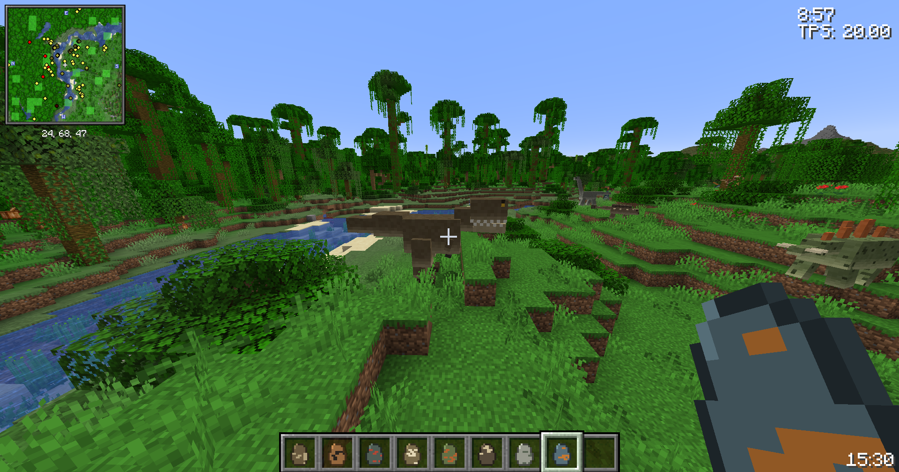
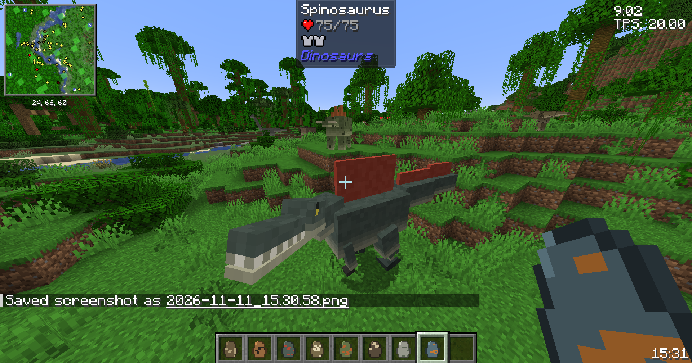
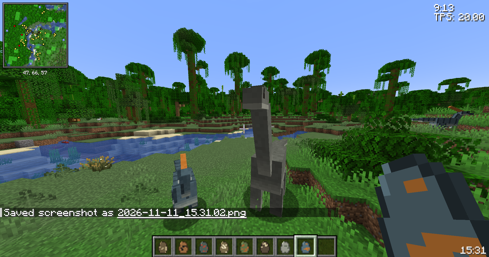
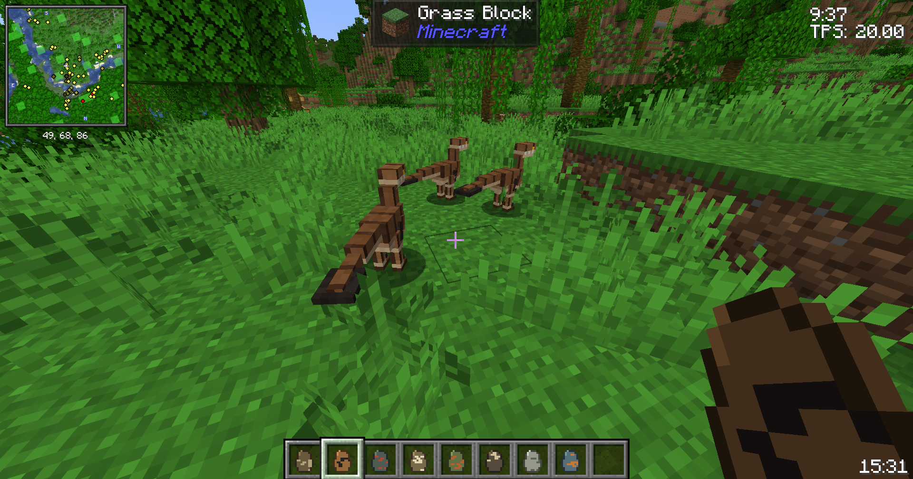
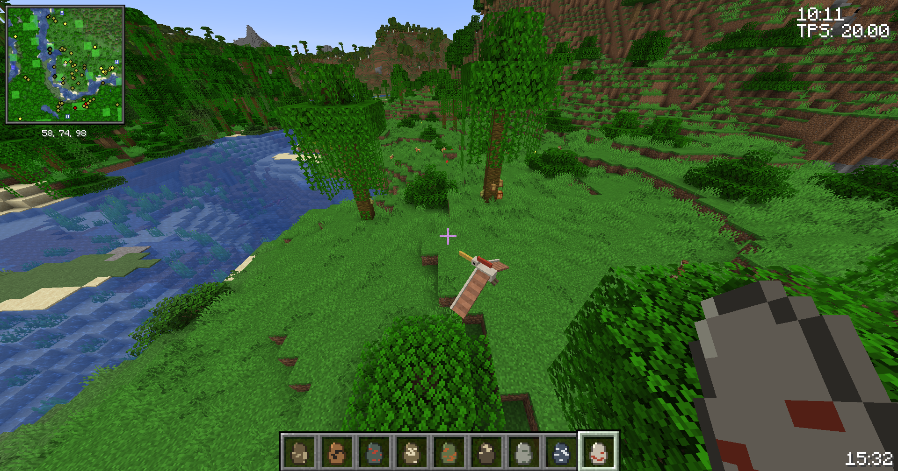
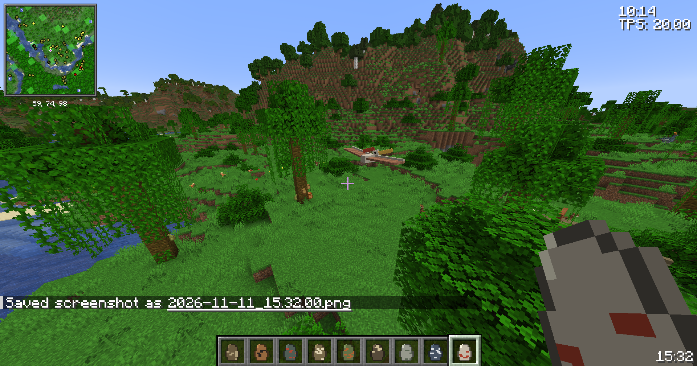
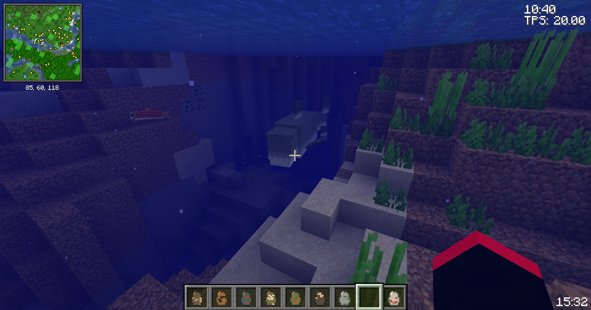

# Dinosaurs (Fabric mod for Minecraft 26.2 / 26.3)

Modrinth: https://modrinth.com/mod/dinosaurs-mod

Adds well-known prehistoric animals as new mobs. Every species lives in its own biomes, so the world
is spread out instead of everything spawning in one place. Behaviour follows current science:
carnivores are hostile, armoured or horned herbivores defend themselves, the others run away.

## Mobs

| Mob | Behaviour | Spawns in | Drops |
|-----|-----------|-----------|-------|
| Tyrannosaurus Rex | Hostile, rare (max 1 per area) | Plains, Sunflower Plains, Forest, Dark Forest | 4-8 bones, bone meal, 1-2 **T-Rex Teeth** |
| Velociraptor (feathered) | Hostile, small packs; hitting one alerts the pack | Savanna, Savanna Plateau, Windswept Savanna, Badlands (all 3) | 0-2 bones, 0-1 **Raptor Claw** |
| Spinosaurus (sail, semi-aquatic) | Hostile, rare | Mangrove Swamp, Beach | 4-7 bones, bone meal |
| Triceratops | Neutral: fights back when hit; **rideable with a Dinosaur Saddle** | Plains, Sunflower Plains, Meadow | 2-5 bones, bone meal |
| Stegosaurus | Neutral: fights back when hit | Forest, Flower Forest, Birch Forest, Old Growth Birch Forest | 2-5 bones, bone meal |
| Ankylosaurus (heavily armoured) | Neutral: fights back when hit | Taiga (all), Windswept Hills / Forest / Gravelly Hills | 2-5 bones, bone meal |
| Brachiosaurus | Passive: flees when hurt and avoids carnivores | Jungle, Sparse Jungle, Bamboo Jungle | 5-9 bones, bone meal, 1-3 **Brachiosaurus Hide** |
| Parasaurolophus | Passive: flees when hurt and avoids carnivores | Swamp, River | 1-3 bones, 0-1 **Parasaurolophus Crest** |
| Megalodon | Hostile to players **in the water**, very rare | Deep Ocean, Deep Cold / Lukewarm / Frozen Ocean | 3-6 bones, bone meal, 1-3 **Megalodon Teeth** |
| Pteranodon | Passive: flies around, perches on the highest nearby point, flees when hurt | Windswept Hills, Windswept Gravelly Hills, Stony Peaks, Jagged Peaks | 0-2 bones |

* Hostile species do not spawn on Peaceful difficulty. Predators spawn during the day too, but they are
  limited per area (for example only one T. rex within 64 blocks) so they never flood a biome.
* Herbivores and pterosaurs stay in the world like vanilla animals; predators despawn like monsters.
* Every mob has a spawn egg (creative tab **Dinosaurs** and the vanilla Spawn Eggs tab).
* Looting increases every drop by up to 1 per level.
* Sounds reuse vanilla sounds.

## Items (1.1.0)

**Amulet of Dino Protection** – while it is anywhere in your inventory (or in the Trinkets necklace slot),
hostile dinosaurs (T. rex, Velociraptor, Spinosaurus, Megalodon) do not target or attack you. If you attack
one of them, *that* dinosaur may fight back; the others keep ignoring you.

```
 string  gold ingot  string
 raptor  T-Rex tooth raptor
 claw                claw
         megalodon
         tooth
```

**Dinosaur Saddle** – use it on a Triceratops to saddle it. Then use the Triceratops with an empty hand to
ride it and steer with the movement keys (W/S/A/D). Sneak + use with an empty hand takes the saddle off.
The saddle is saved with the mob and dropped when it dies.

```
 brachiosaurus hide  leather                brachiosaurus hide
 string              parasaurolophus crest  string
                     iron ingot
```

Advancements: *Dino Whisperer* (get the amulet) and *Three Horns, One Rider* (ride a Triceratops).

## Configuration

`config/dinosaurs.json` (created on first start; changes apply immediately):

* `hostileSpawnInDaylight` (default `true`) – set to `false` and hostile dinosaurs only spawn at night,
  in darkness (light level 7 or less).
* `spawning` – turn natural spawning of each species on or off. Spawn eggs, spawners and `/summon` always work.

With [Mod Menu](https://modrinth.com/mod/modmenu) **and** [Cloth Config](https://modrinth.com/mod/cloth-config)
installed, the same settings are available in-game (Mods → Dinosaurs → config button), in English and Polish.

## Optional integrations

| Mod | What it does |
|-----|--------------|
| [Trinkets Updated](https://modrinth.com/mod/trinkets-updated) (Fabric port of Trinkets) | The amulet goes in the **chest / necklace** slot and protects from there |
| [Mod Menu](https://modrinth.com/mod/modmenu) + [Cloth Config](https://modrinth.com/mod/cloth-config) | In-game config screen |

None of them is required. (Baubles and Curios are Forge/NeoForge-only; Accessories has no build for 26.x.)

## Languages

English and Polish. Minecraft picks the language automatically from the game settings.

## Requirements

* Minecraft 26.2 or 26.3 (use the matching jar)
* Fabric Loader 0.19.5+ (26.2) / 0.20.1+ (26.3)
* [Fabric API](https://modrinth.com/mod/fabric-api)
* Java 25
* Optional: Trinkets Updated, Mod Menu, Cloth Config (see above)

Install on the server **and** on every client.

## Screenshots

These are in-game screenshots of the mobs:















## Building

```bash
./gradlew build                     # jar in build/libs/
python3 tools/gen_assets.py         # regenerates models (DinoModelLayers.java), textures, spawn egg icons
python3 tools/gen_data.py           # regenerates lang files, loot tables, item models, recipes, advancements
python3 tools/gen_items.py          # regenerates the item textures and the Triceratops saddle overlay
./tools/server-test.sh              # headless dedicated-server smoke test
./gradlew runGameTest               # server game tests (amulet, saddle/riding, config, recipes); add -PwithTrinkets=true
```

Branches: `master` targets Minecraft 26.3, branch `26.2` targets Minecraft 26.2.

## License

MIT

---

## Po polsku

Mod dodaje do Minecrafta dinozaury (i dwa inne prehistoryczne zwierzęta). Każdy gatunek ma swoje biomy,
więc nie pojawiają się wszystkie w jednym miejscu.

* **Wrogie (mięsożerne):** Tyranozaur (równiny, lasy, rzadki), Welociraptor (sawanny i badlandy, w małych stadach),
  Spinozaur (bagna namorzynowe i plaże), Megalodon (głębokie oceany, atakuje tylko gracza w wodzie).
* **Neutralne (bronią się, gdy je uderzysz):** Triceratops (równiny, łąki), Stegozaur (lasy, lasy brzozowe),
  Ankylozaur (tajgi, wietrzne wzgórza).
* **Pokojowe (uciekają):** Brachiozaur (dżungle), Parazaurolof (bagna, rzeki),
  Pteranodon (góry: lata i siada na najwyższych punktach).
* Łupy: kości (większe zwierzęta dają więcej) i mączka kostna. Każde zwierzę ma jajo przywołania w trybie kreatywnym.
* **Nowe w 1.1.0:** zęby tyranozaura, pazury raptora i zęby megalodona → **Amulet ochrony przed dinozaurami**
  (wrogie dinozaury cię ignorują, dopóki ich nie zaatakujesz; działa w ekwipunku i w slocie naszyjnika Trinkets).
  Skóra brachiozaura i grzebień parazaurolofa (+ skóra, nić, żelazo) → **Siodło na dinozaura**: użyj go na
  triceratopsie, a potem pustą ręką, żeby na nim jeździć (WASD). Kucnięcie + pusta ręka zdejmuje siodło.
* **Konfiguracja** (`config/dinosaurs.json`, albo w grze przez Mod Menu + Cloth Config): wyłączenie pojawiania się
  wrogich dinozaurów za dnia oraz osobny przełącznik pojawiania się dla każdego gatunku.
* Na poziomie trudności „Pokojowy” wrogie gatunki się nie pojawiają.
* Mod jest po polsku i po angielsku – język zmienia się automatycznie razem z językiem gry.
