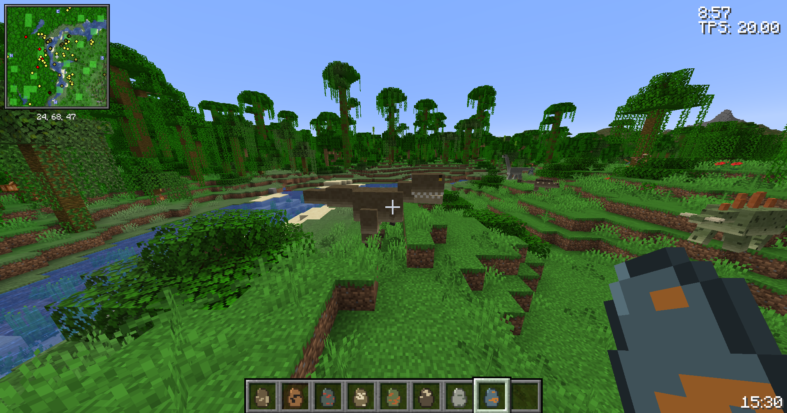
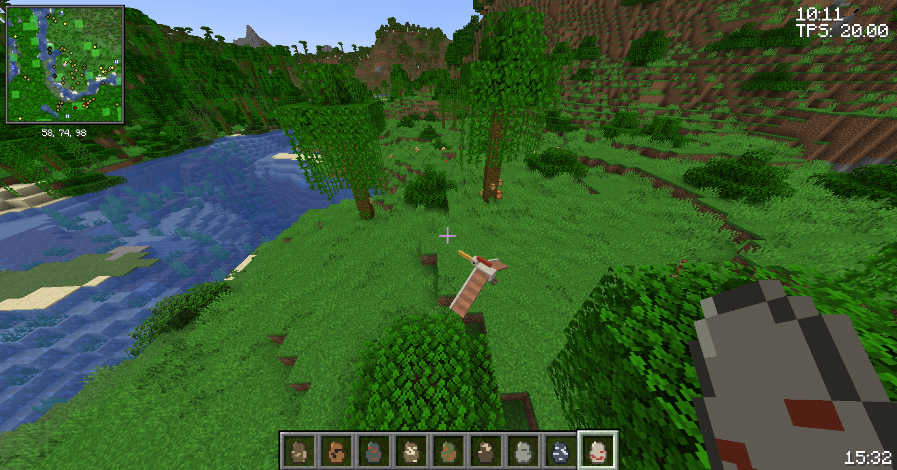
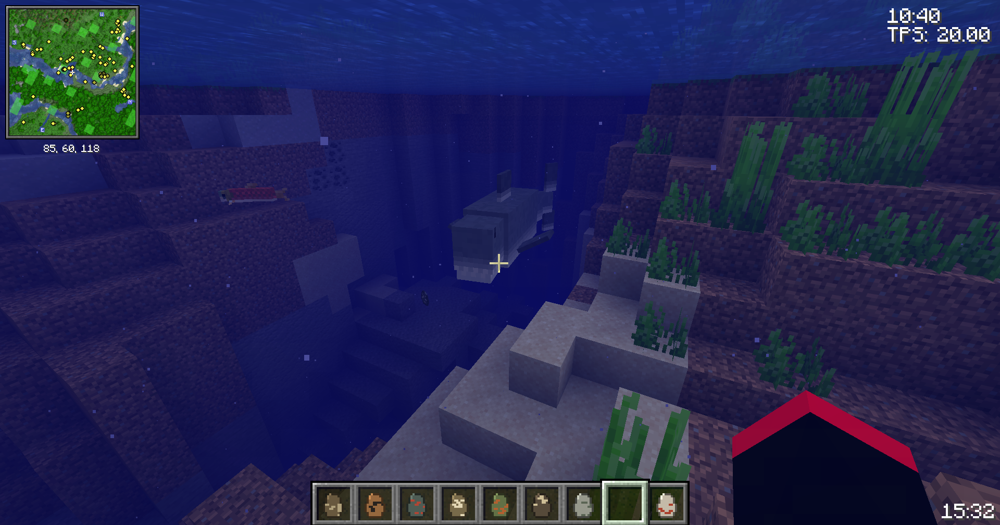

# Dinosaurs (Fabric mod for Minecraft 26.2 / 26.3)

Modrinth: https://modrinth.com/mod/dinosaurs-mod

Adds well-known prehistoric animals as new mobs. Every species lives in its own biomes, so the world
is spread out instead of everything spawning in one place. Behaviour follows current science:
carnivores are hostile, armoured or horned herbivores defend themselves, the others run away.

## Mobs

| Mob | Behaviour | Spawns in | Drops |
|-----|-----------|-----------|-------|
| Tyrannosaurus Rex | Hostile, rare (max 1 per area) | Plains, Sunflower Plains, Forest, Dark Forest | 2-4 **Dinosaur Bones**, bone meal, 1-2 **T-Rex Teeth**, rarely a **T-Rex Skull** |
| Velociraptor (feathered) | Hostile, small packs; hitting one alerts the pack | Savanna, Savanna Plateau, Windswept Savanna, Badlands (all 3) | 0-2 bones, 0-1 **Raptor Claw** |
| Spinosaurus (sail, semi-aquatic) | Hostile, rare | Mangrove Swamp, Beach | 2-4 **Dinosaur Bones**, bone meal |
| Triceratops | Neutral: fights back when hit; **rideable with a Dinosaur Saddle** | Plains, Sunflower Plains, Meadow | 1-3 **Dinosaur Bones**, bone meal |
| Stegosaurus | Neutral: fights back when hit | Forest, Flower Forest, Birch Forest, Old Growth Birch Forest | 1-3 **Dinosaur Bones**, bone meal |
| Ankylosaurus (heavily armoured) | Neutral: fights back when hit | Taiga (all), Windswept Hills / Forest / Gravelly Hills | 1-3 **Dinosaur Bones**, bone meal |
| Brachiosaurus | Passive: flees when hurt and avoids carnivores | Jungle, Sparse Jungle, Bamboo Jungle | 2-5 **Dinosaur Bones**, bone meal, 1-3 **Brachiosaurus Hide** |
| Parasaurolophus | Passive: flees when hurt and avoids carnivores | Swamp, River | 1-2 **Dinosaur Bones**, 0-1 **Parasaurolophus Crest** |
| Megalodon | Hostile to players **in the water**, very rare | Deep Ocean, Deep Cold / Lukewarm / Frozen Ocean | 3-6 bones, bone meal, 1-3 **Megalodon Teeth** |
| Pteranodon | Passive: flies around, perches on the highest nearby point, flees when hurt | Windswept Hills, Windswept Gravelly Hills, Stony Peaks, Jagged Peaks | 0-2 bones |

* Hostile species do not spawn on Peaceful difficulty. Predators spawn during the day too, but they are
  limited per area (for example only one T. rex within 64 blocks) so they never flood a biome.
* Herbivores and pterosaurs stay in the world like vanilla animals; predators despawn like monsters.
* Every mob has a spawn egg (creative tab **Dinosaurs** and the vanilla Spawn Eggs tab).
* Looting increases every drop by up to 1 per level (the rare T-Rex Skull: 4%, with Looting I/II/III 6/8/10%).
* Sounds reuse vanilla sounds.

## Items (1.1.0)

**Amulet of Dino Protection** – while it is anywhere in your inventory (or in the Trinkets necklace slot),
hostile dinosaurs (T. rex, Velociraptor, Spinosaurus, Megalodon) do not target or attack you. If you attack
one of them, *that* dinosaur may fight back; the others keep ignoring you.

```
 string  gold ingot  string
 raptor  T-Rex tooth raptor
 claw                claw
         megalodon
         tooth
```

**Dinosaur Saddle** – use it on a Triceratops to saddle it. Then use the Triceratops with an empty hand to
ride it and steer with the movement keys (W/S/A/D). Sneak + use with an empty hand takes the saddle off.
The saddle is saved with the mob and dropped when it dies.

```
 brachiosaurus hide  leather                brachiosaurus hide
 string              parasaurolophus crest  string
                     iron ingot
```

**Dinosaur Field Guide** (1.2.0) – an illustrated guide book. Right-click it to open: a clickable table of
contents, a page for every dinosaur with a 3D picture (drag it to rotate), where it lives and what it drops,
plus every item with its crafting grid (click an ingredient to jump to its page) and the current spawn settings.

```
 shapeless: book + leather + any dinosaur trophy
 (T-Rex tooth, raptor claw, megalodon tooth, brachiosaurus hide or parasaurolophus crest)
```

Book + leather alone is left free so it cannot clash with other mods' guide books; the trophy
(item tag `#dinosaurs:guide_book_trophies`) makes the recipe unique.

**T-Rex Skull Helmet** (1.3.0) – the T. rex rarely drops a **T-Rex Skull** (only when killed by a player:
4% of the time, 6/8/10% with Looting I/II/III). Craft it into a helmet you wear as a 3D T. rex skull, snout
forward, with teeth and eye sockets (on players, armor stands, mannequins and mobs alike). Better than netherite:

| | T-Rex Skull Helmet | Netherite Helmet |
|---|---|---|
| Armor | 4 | 3 |
| Armor Toughness | 3.5 | 3 |
| Knockback Resistance | 0.15 | 0.1 |
| Durability | 506 | 407 |
| Enchantability | 15 | 15 |

Fire resistant like netherite, takes all helmet enchantments (`#minecraft:head_armor`), repaired with a
netherite ingot or another T-Rex Skull.

```
 shapeless: T-Rex skull + leather + netherite ingot
```

**Dinosaur Bone Bow** (1.4.0) – the seven large dinosaurs (T. rex, Spinosaurus, Brachiosaurus, Triceratops,
Stegosaurus, Ankylosaurus, Parasaurolophus) now drop **Dinosaur Bones** instead of vanilla bones; Velociraptor,
Pteranodon and Megalodon (a shark: cartilage, not dinosaur bone) keep vanilla bones. One Dinosaur Bones also crafts
into 4 bone meal. Three of them upgrade a bow:

```
  .  B  .     B = Dinosaur Bones
  B  W  B     W = Bow
  .  N  .     N = Netherite Ingot
```

| | Dinosaur Bone Bow | Bow |
|---|---|---|
| Full draw | 15 ticks (0.75 s) | 20 ticks (1 s) |
| Arrow speed at full draw | 4.5 | 3 |
| Arrow damage at full draw (no Power) | 9 | 6 |
| Durability | 1152 | 384 |
| Enchantability | 15 | 1 |

Arrows fly 1.5x faster and farther and hit harder; it takes every bow enchantment, is fire resistant and is
repaired with Dinosaur Bones. **Infinity and Mending can be on it together** – combine them in an anvil or with
`/enchant`; on every other bow the vanilla rule still applies. Draw animation and FOV zoom work like a vanilla bow.

Advancements: *Dino Whisperer* (get the amulet) and *Three Horns, One Rider* (ride a Triceratops).

## Configuration

`config/dinosaurs.json` (created on first start; changes apply immediately):

* `hostileSpawnInDaylight` (default `true`) – set to `false` and hostile dinosaurs only spawn at night,
  in darkness (light level 7 or less).
* `spawning` – turn natural spawning of each species on or off. Spawn eggs, spawners and `/summon` always work.

With [Mod Menu](https://modrinth.com/mod/modmenu) **and** [Cloth Config](https://modrinth.com/mod/cloth-config)
installed, the same settings are available in-game (Mods → Dinosaurs → config button), in English and Polish.

## Optional integrations

| Mod | What it does |
|-----|--------------|
| [Trinkets Updated](https://modrinth.com/mod/trinkets-updated) (Fabric port of Trinkets) | The amulet goes in the **chest / necklace** slot and protects from there |
| [Mod Menu](https://modrinth.com/mod/modmenu) + [Cloth Config](https://modrinth.com/mod/cloth-config) | In-game config screen |

None of them is required. (Baubles and Curios are Forge/NeoForge-only; Accessories has no build for 26.x.)

## Languages

English and Polish. Minecraft picks the language automatically from the game settings.

## Requirements

* Minecraft 26.2 or 26.3 (use the matching jar)
* Fabric Loader 0.19.5+ (26.2) / 0.20.1+ (26.3)
* [Fabric API](https://modrinth.com/mod/fabric-api)
* Java 25
* Optional: Trinkets Updated, Mod Menu, Cloth Config (see above)

Install on the server **and** on every client.

## Screenshots

These are in-game screenshots of the mobs:









## Building

```bash
./gradlew build                     # jar in build/libs/
python3 tools/gen_assets.py         # regenerates models (DinoModelLayers.java), textures, spawn egg icons
python3 tools/gen_data.py           # regenerates lang files, loot tables, item models, recipes, advancements
python3 tools/gen_items.py          # regenerates the item textures and the Triceratops saddle overlay
./tools/server-test.sh              # headless dedicated-server smoke test
python3 tools/gen_bow.py /path/to/vanilla/textures/item   # Dinosaur Bones and Bone Bow textures
python3 tools/gen_skull.py          # regenerates the 3D T-Rex Skull / helmet models and their textures
./gradlew runGameTest               # server game tests (amulet, saddle/riding, config, recipes, guide book, helmet, skull loot, bone bow, Infinity + Mending, dinosaur bones loot); add -PwithTrinkets=true
SDL_VIDEODRIVER=offscreen ./gradlew runClientGameTest   # guide book layout check + screenshots, helmet, bone bow and mob screenshots
```

Branches: `master` targets Minecraft 26.3, branch `26.2` targets Minecraft 26.2.

## License

MIT

---

## Po polsku

Mod dodaje do Minecrafta dinozaury (i dwa inne prehistoryczne zwierzęta). Każdy gatunek ma swoje biomy,
więc nie pojawiają się wszystkie w jednym miejscu.

* **Wrogie (mięsożerne):** Tyranozaur (równiny, lasy, rzadki), Welociraptor (sawanny i badlandy, w małych stadach),
  Spinozaur (bagna namorzynowe i plaże), Megalodon (głębokie oceany, atakuje tylko gracza w wodzie).
* **Neutralne (bronią się, gdy je uderzysz):** Triceratops (równiny, łąki), Stegozaur (lasy, lasy brzozowe),
  Ankylozaur (tajgi, wietrzne wzgórza).
* **Pokojowe (uciekają):** Brachiozaur (dżungle), Parazaurolof (bagna, rzeki),
  Pteranodon (góry: lata i siada na najwyższych punktach).
* Łupy: kości (duże dinozaury: kości dinozaura) i mączka kostna. Każde zwierzę ma jajo przywołania w trybie kreatywnym.
* **Nowe w 1.1.0:** zęby tyranozaura, pazury raptora i zęby megalodona → **Amulet ochrony przed dinozaurami**
  (wrogie dinozaury cię ignorują, dopóki ich nie zaatakujesz; działa w ekwipunku i w slocie naszyjnika Trinkets).
  Skóra brachiozaura i grzebień parazaurolofa (+ skóra, nić, żelazo) → **Siodło na dinozaura**: użyj go na
  triceratopsie, a potem pustą ręką, żeby na nim jeździć (WASD). Kucnięcie + pusta ręka zdejmuje siodło.
* **Nowe w 1.2.0: Przewodnik po dinozaurach** – ilustrowana książka (bez kształtu: książka + skóra + dowolne
  trofeum dinozaura: ząb, pazur, skóra lub grzebień). Każdy dinozaur z obrazkiem 3D, opisem, biomami i łupami,
  wszystkie receptury z klikalnymi składnikami oraz aktualne ustawienia pojawiania się.
* **Nowe w 1.3.0: Hełm z czaszki tyranozaura** – tyranozaur zabity przez gracza rzadko upuszcza **czaszkę**
  (4%, z Grabieżą I/II/III 6/8/10%). Czaszka + skóra + sztabka netherytu (bez kształtu) = hełm, który na głowie
  wygląda jak trójwymiarowa czaszka tyranozaura. Mocniejszy niż netherytowy (pancerz 4, twardość 3,5,
  odporność na odrzut 0,15, trwałość 506), odporny na ogień, naprawiany sztabką netherytu lub czaszką.
* **Nowe w 1.4.0: Łuk z kości dinozaura** – duże dinozaury (tyranozaur, spinozaur, brachiozaur, triceratops,
  stegozaur, ankylozaur, parazaurolof) upuszczają **kości dinozaura** zamiast zwykłych kości (welociraptor,
  pteranodon i megalodon – zwykłe kości). Łuk + 3 kości dinozaura + sztabka netherytu = łuk, który naciąga się
  w 15 ticków zamiast 20, strzela 1,5× szybciej (obrażenia 9 zamiast 6), ma trwałość 1152, jest odporny na ogień
  i naprawiany kośćmi dinozaura. **Nieskończoność i Naprawa działają na nim razem** (kowadło lub `/enchant`).
  1 kość dinozaura = 4 mączki kostne.
* **Konfiguracja** (`config/dinosaurs.json`, albo w grze przez Mod Menu + Cloth Config): wyłączenie pojawiania się
  wrogich dinozaurów za dnia oraz osobny przełącznik pojawiania się dla każdego gatunku.
* Na poziomie trudności „Pokojowy” wrogie gatunki się nie pojawiają.
* Mod jest po polsku i po angielsku – język zmienia się automatycznie razem z językiem gry.
